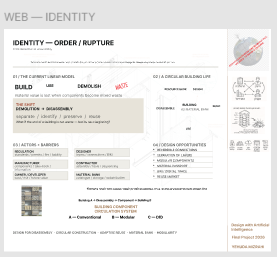

# 03 — Figma Design Process

## Overview

Figma was used as the primary environment for developing the project's visual identity.

The design process began with an A0 poster and continued with the adaptation of its visual composition into a web-oriented format.

## Stage 1 — Original A0 Poster

An original A0 poster was created to explore the visual concept ORDER / RUPTURE.

The poster established the initial visual language, including typography, graphic elements, spatial relationships and composition.

**Documentation:** Original A0 poster screenshot.

## Stage 2 — Creating the Web Frame

A separate frame named `WEB — IDENTITY` was created in Figma.

Frame dimensions:

- Width: 1440 px
- Height: 1200 px

The original poster was preserved as a separate design artifact.

## Stage 3 — Adapting the Composition

The poster elements were copied into the new web frame and adjusted to fit its dimensions.

At this stage, the composition remained largely intact rather than being redesigned as separate website sections.

## Stage 4 — Graphic Intervention

The word `WASTE` was modified through changes in size, position and rotation.

This intervention introduced a deliberate visual disruption and reinforced the RUPTURE principle.

assets/images/Changing the Order 01.png

## Design Decisions

- Preserve the original A0 poster.
- Maintain a separate web-oriented frame.
- Retain the overall visual composition.
- Use deliberate graphic deviations to express the concept.
- Develop the design as a single-page personal identity.

## Next Steps

The next stage is to translate the Figma composition into a functional website using HTML and CSS.

---

*This document records the initial transition from graphic composition to digital identity design.*
